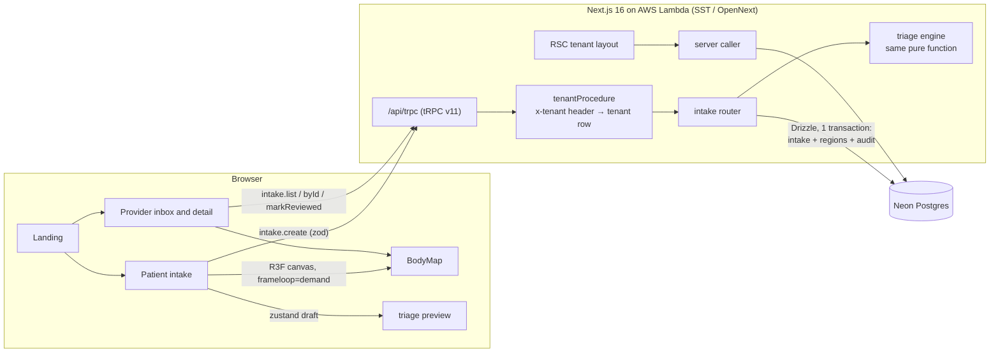

# CareMap

**Tap where it hurts.** CareMap is a phone-first 3D symptom intake for telehealth. A patient taps a body, describes each area, sees exactly how the intake will be routed, and sends it. The clinic's provider sees the same body with severity pins, the triage reasons, and an audit trail.

> Demo only. Every intake is synthetic. The app collects no names or identifiers, and every page carries a "do not enter real health information" banner.

**What to try**

1. Open `/` and pick a clinic (Lumen Health or Northwind Care). Each clinic has its own brand colours, which flow through the UI and into the 3D materials.
2. **Patient intake:** tap the chest, crank severity to 10, and watch the review step flag it as urgent, with the rule that fired.
3. **Provider:** open the inbox. Urgent intakes come first. Open one, orbit the body, tap an area in the table to focus the camera, then press **Mark reviewed**.

On desktop, the landing page shows a QR code so you can open the same URL on your phone.

## Architecture



| Layer | Choice |
| --- | --- |
| UI | Next.js 16 (App Router, Turbopack), React 19, Tailwind v4, shadcn on Base UI, motion |
| 3D | React Three Fiber 9, drei 10, three r186, procedural mannequin (no model download) |
| API | tRPC v11 with `@trpc/tanstack-react-query`, superjson, shared zod 4 schemas |
| Data | Drizzle ORM. Neon Postgres in production; PGlite (in-process Postgres) locally and in CI |
| Infra | SST v4 `sst.aws.Nextjs` (OpenNext on Lambda + CloudFront), `DatabaseUrl` as an SST secret |
| Tests | Vitest (triage table tests, schema tests, tRPC integration on PGlite), Playwright on iPhone 13 WebKit and desktop Chromium, GitHub Actions |

### Code map

```
src/
  app/                      routes: landing, /t/[tenant]/intake, /t/[tenant]/provider[/id], /api/trpc
  components/body-map/      R3F canvas, region meshes, instanced pins, camera rig, SVG poster fallback
  components/intake/        stepper flow, region picker (accessible equivalent of the canvas), details form
  components/provider/      inbox and intake detail
  lib/                      regions, zod schemas, triage engine, brand helpers (shared client + server)
  server/api/               tRPC init, tenantProcedure, routers
  server/db/                Drizzle schema, driver selection, seed
  stores/intake-draft.ts    zustand draft for the patient flow
tests/integration/          tRPC routers against in-memory PGlite
tests/e2e/                  Playwright
```

## Running locally

Requires Node 24 and pnpm 10.

```bash
pnpm install
pnpm dev            # http://localhost:3000
```

No database setup is needed. With `DATABASE_URL` unset, the app starts an embedded Postgres (PGlite) in `./.pglite`, applies the migrations in `drizzle/`, and seeds two demo clinics with sample intakes. Delete `.pglite/` to reset. Use `DATABASE_URL=pglite://memory` for a throwaway database.

Add `?perf` to any URL in dev to show a GPU/CPU stats overlay.

| Command | What it does |
| --- | --- |
| `pnpm typecheck` | `tsc --noEmit` |
| `pnpm lint` | ESLint |
| `pnpm test` | Vitest: triage rules, schemas, tRPC routers incl. tenant isolation |
| `pnpm test:e2e` | Builds, starts on :3300 with in-memory PGlite, runs Playwright (mobile WebKit + desktop Chromium) |
| `pnpm db:generate` | Generate a migration after editing `src/server/db/schema.ts` |
| `pnpm db:migrate` / `pnpm db:seed` | Migrate / reseed the database at `DATABASE_URL` |

First Playwright run: `pnpm exec playwright install chromium webkit`.

## Deploying to AWS

1. `aws configure` (or `aws sso login`) with credentials for the target account.
2. Create a Neon project and copy its **pooled** connection string.
3. Migrate and seed it:
   ```bash
   DATABASE_URL="postgres://…" pnpm db:migrate
   DATABASE_URL="postgres://…" pnpm db:seed
   ```
4. Store the URL as an SST secret and deploy:
   ```bash
   pnpm sst secret set DatabaseUrl "postgres://…" --stage production
   pnpm deploy                       # sst deploy --stage production
   ```
5. SST prints the CloudFront URL. Set `SITE_URL` to it, for absolute Open Graph URLs, and redeploy.

`pnpm sst:dev` runs a personal dev stage with live Lambda reloading.

## Decisions

**Triage is a pure function shared by client and server.** `src/lib/triage.ts` has no I/O. The review step runs it for an instant preview. `intake.create` ignores anything the client claims and runs it again on the server, inside the same transaction that writes the intake and its audit events, so the stored level always matches the stored regions. Each rule returns a plain-language reason, and those reasons are what both the patient and the provider see. Every rule has table-driven tests at, just below and just above its threshold.

**Tenancy lives in one middleware.** The client sends `x-tenant`. `tenantProcedure` resolves it to a tenant row or fails, and every query filters by `ctx.tenant.id`. Fetching another clinic's intake by id returns `NOT_FOUND`. Integration tests cover isolation for list, detail and review. Brand colours are validated hex values injected as `:root` CSS variables, so portalled UI like the mobile drawer inherits them, and they are read by `useBrandColors` for the 3D materials.

**Neon over RDS.** Lambda plus a traditional Postgres means connection storms and a VPC. Neon's serverless driver connects over WebSockets from Lambda without a VPC, scales to zero for a demo, and its branching suits preview stages. RDS Proxy with Aurora Serverless v2 would be the choice inside a stricter AWS-only compliance boundary.

**Neon WebSocket `Pool`, not the HTTP driver.** The HTTP driver can't run interactive transactions, and `intake.create` and `markReviewed` both need one. The pool is capped at 3 connections per Lambda instance.

**PGlite for local dev, tests and CI.** The same Drizzle schema and migrations run against real Postgres compiled to WASM, in process. There's no Docker or shared dev database, and CI needs no secrets. Integration tests get a fresh in-memory database per suite in milliseconds. The driver is picked by URL scheme (`pglite://` or `postgres://`) in `src/server/db/index.ts`.

**SST v4, not v3.** v4 was current when this was built. The `sst.aws.Nextjs` component is unchanged from v3; v4 brings a newer OpenNext and the nodejs24.x runtime.

**shadcn on Base UI, not Radix.** The current shadcn default ("base-nova") builds on Base UI. Its Drawer handles swipe-to-dismiss and safe areas well on iOS, which mattered more than Radix familiarity.

**Procedural mannequin instead of a GLB.** The body is 19 primitive meshes, one per tappable region. Nothing to download, hit-testing is exact per region, and the regions can be glowed and recoloured per tenant without texture work. A realistic scanned body would make it harder to read, not easier.

**Rendering on demand.** The canvas uses `frameloop="demand"`. It renders only when the camera moves, a glow animates, or pins change, and every animation stops invalidating once settled. Idle, it issues zero draw calls, which is what keeps a mid-range phone cool. The e2e suite checks that the main thread holds 50fps or more with the scene idle. `PerformanceMonitor` drops the pixel ratio from 2 to 1 on slow devices. Environment lighting and contact shadows render once.

Lighthouse 12, mobile preset, local production build:

| Page | Performance | Accessibility | Best practices | SEO |
| --- | --- | --- | --- | --- |
| Landing (3D hero) | 91 | 100 | 100 | 100 |
| Patient intake | 83 | 100 | 100 | 100 |
| Provider inbox | 97 | 100 | 100 | 100 |

The remaining blocking time on the 3D pages is the first WebGL frame, which compiles the shaders and bakes the environment map. Headless Chrome does that on a software rasteriser, so a real phone's GPU does much better.

**A raw `instancedMesh` for pins instead of drei `<Instances>`.** With the demand frameloop, drei's instances wrote their matrices on a frame that never came, so pins rendered at the origin. Writing matrices in a layout effect and calling `invalidate()` is simpler and deterministic.

**drei `StatsGl` instead of `r3f-perf`.** r3f-perf pulled in a second copy of drei (v9), and its bundled font source map crashed Turbopack. `StatsGl` is lazy-loaded in development only, behind `?perf`.

**Cache Components off.** Next 16's `cacheComponents` and partial prefetching aren't yet supported by OpenNext on Lambda. Pages here are tenant-dynamic and tiny, so there was little to gain.

**Motion is short and skippable.**

| Motion | Timing |
| --- | --- |
| Step transitions | 220ms, ease-out-expo |
| Camera moves | 320ms smoothing |
| Region glow | Exponential damping, settles in about 200ms |
| Drawer | 450ms (Base UI default) |
| Landing hero | Cycles every 2.8s |

With `prefers-reduced-motion` on, step transitions cross-fade, camera moves jump, glows snap, and the hero stops.

**Accessibility.** Everything the canvas does has a non-canvas equivalent. The region list is a set of `aria-pressed` toggles grouped in fieldsets. The canvas is `role="img"` with a live description of what's selected. Severity is a labelled slider with value text, and it is never shown by colour alone. Focus moves to each step's heading. Region chips and step actions are at least 44px tall on mobile.

## Not built (yet)

- Auth: the provider view is open, with a fixed "Demo clinician" reviewer. Real deployments would put the provider routes behind clinic SSO and record the actual reviewer.
- PHI controls: encryption at rest per tenant, retention policies, BAAs and access logging beyond the audit trail.
- i18n and translated triage copy.
